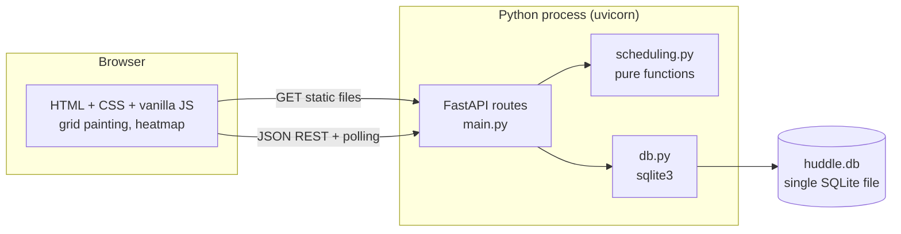

# System Requirements — huddle-app-lite

| | |
|---|---|
| **Version** | 0.1 (draft) |
| **Date** | 2026-11-15 |
| **Status** | For review |
| **Architecture** | See the overview below |

---

## 1. Purpose

A lightweight, self-hosted group scheduling web app inspired by when2meet.com.
An organizer creates an event with candidate dates and a daily time window and
shares a link. Each participant paints the times they're free on a grid. The app
shows a group heatmap and suggests the best meeting times.

The app must **launch locally with one command** and feel **instant**.

---

## Architecture Overview

The browser uses a small vanilla JavaScript interface for grid editing and
heatmap rendering. A single uvicorn process serves the static frontend and
FastAPI routes, keeps scheduling logic separate from I/O, and persists all
application data in one local SQLite database.

---

## 2. Scope

### In scope (v1)

- Creating events, sharing them by link, entering availability, group heatmap, best-time suggestions
- Running locally on one machine (optionally reachable on the LAN)
- Persisting data in a single local file

### Out of scope (v1)

- User accounts, email, notifications
- Calendar sync (Google/Outlook), see Future Work
- Public internet hosting, horizontal scaling
- Native mobile apps (mobile **web** is in scope)

---

## 3. Users

| Persona | Goal |
|---|---|
| **Organizer** | Create an event fast, share it, see when most people are free |
| **Participant** | Open the link, enter a name, mark availability in under a minute |

No sign-up for either. Identity is a name within an event, with an optional password.

---

## 4. Functional Requirements

Priority: **M** = Must, **S** = Should, **C** = Could.

### 4.1 Event creation

| ID | Requirement | Pri |
|---|---|---|
| FR-1 | Organizer creates an event with a **name**, one or more **specific dates**, a **daily time window** (e.g. 09:00–17:00), and a **slot size** (default 15 min; allowed 15/30/60). | M |
| FR-2 | The system creates a **unique, hard-to-guess URL** for the event. | M |
| FR-3 | Organizer may choose **days of the week** (Mon–Sun) instead of specific dates. | S |
| FR-4 | Each event stores a **timezone** (defaults to the organizer's browser timezone). | M |

### 4.2 Participation

| ID | Requirement | Pri |
|---|---|---|
| FR-5 | A participant joins by entering a **name** (unique within the event). | M |
| FR-6 | A participant may set an optional **password** to protect their entry. | S |
| FR-7 | A participant marks availability by **click-and-drag** on a grid (dates as columns, time slots as rows). Dragging from a busy cell marks free, and from a free cell marks busy. | M |
| FR-8 | The grid supports **touch** input on mobile browsers. | M |
| FR-9 | Changes **auto-save** with no explicit submit button. | M |
| FR-10 | A returning participant (same name, plus password if set) can **edit** their availability. | M |

### 4.3 Group view

| ID | Requirement | Pri |
|---|---|---|
| FR-11 | Show a **heatmap** grid where color intensity = number of people free in each slot. | M |
| FR-12 | Hovering or tapping a slot shows **who is free** and **who is not**. | M |
| FR-13 | The group view **refreshes automatically** when others save (within 5 s). | S |
| FR-14 | Times can be **displayed in the viewer's timezone**. | C |

### 4.4 Suggestions

| ID | Requirement | Pri |
|---|---|---|
| FR-15 | Given a meeting **duration**, show the **earliest time when everyone is free** for the whole duration, or "no common time". | M |
| FR-16 | Show the **top 3 windows** where the **most people** can attend the whole duration (ties → earliest). | M |
| FR-17 | Suggested meetings must **not cross a day boundary** or fall outside the daily window. | M |
| FR-18 | Export a chosen time as an **.ics** calendar file. | C |

---

## 5. Non-Functional Requirements

### 5.1 Launch & footprint

| ID | Requirement |
|---|---|
| NFR-1 | Starts with **one command** after install (e.g. `python -m app`). |
| NFR-2 | Server is ready in **< 1 s**. |
| NFR-3 | **≤ 3** direct Python dependencies. **No** Node/npm and **no** frontend build step. |
| NFR-4 | **No external services**: no separate database server, no cloud, works offline. |
| NFR-5 | All data lives in **one SQLite file**, so backup = copy the file. |

### 5.2 Performance (local machine)

| ID | Requirement |
|---|---|
| NFR-6 | First page load **< 200 ms**; total page weight **< 100 KB**. |
| NFR-7 | API responses **p95 < 50 ms** for an event with 50 participants × 7 days × 96 slots. |
| NFR-8 | Grid painting stays **smooth** (no visible lag while dragging). |

### 5.3 Reliability & security

| ID | Requirement |
|---|---|
| NFR-9 | No data loss on normal shutdown or crash after a save is acknowledged. |
| NFR-10 | Event URLs are unguessable (≥ 64 bits of randomness). |
| NFR-11 | Passwords are **hashed**, never stored in plain text. |
| NFR-12 | All user text (names, event titles) is **escaped** to prevent XSS. All input is validated server-side. |

### 5.4 Usability & maintainability

| ID | Requirement |
|---|---|
| NFR-13 | Works in current Chrome, Firefox, Safari, and Edge, on desktop and mobile. |
| NFR-14 | Scheduling logic is **pure functions** with unit tests. |
| NFR-15 | Code passes the "no second-guessing" naming rule: no single-letter or generic names outside short loops. |

---

## 6. Constraints & Assumptions

- Python 3.10+ is installed on the host machine.
- Typical event: ≤ 50 participants, ≤ 14 dates, ≤ 24 h window → ≤ 1,344 slots at 15 min.
- One person edits only their own row, so write conflicts are rare.
- The app is trusted-network software, not hardened for public internet exposure.

---

## 7. Acceptance Criteria (v1)

1. A new user can install and launch the app in under 2 minutes using the README.
2. An organizer can create an event and copy its link in under 30 seconds.
3. A participant can join and mark a week of availability in under 1 minute, on desktop or phone.
4. With 3 participants whose availability overlaps only at Tue 14:00–15:00, a 60-minute suggestion returns **Tue 14:00**.
5. With no full overlap, FR-15 reports "no common time" and FR-16 still lists the best partial windows.
6. All NFR-6/NFR-7 timings are met on a typical laptop.

---

## 8. Future Work

- Calendar import (.ics or Google) to auto-fill busy times. This reuses the interval-merge algorithm.
- "If needed" availability (a second, weaker state per slot)
- Organizer-only settings (lock, delete event)
- Optional Docker image for one-line deployment

---

## 9. Glossary

| Term | Meaning |
|---|---|
| **Slot** | Smallest time unit on the grid (default 15 min). |
| **Daily window** | Time range shown each day, e.g. 09:00–17:00. |
| **Availability** | Per-participant record of which slots they're free. |
| **Heatmap** | Grid colored by how many participants are free per slot. |
